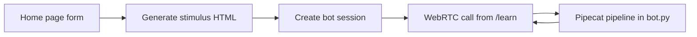

# Nova

Nova is a role-play language tutor you talk to over a live video call. You describe a scene (ordering at a restaurant, buying a train ticket), pick the language you speak and the one you are learning, and an AI avatar plays the other person in that scene and speaks back in the target language.

Demo video: https://www.youtube.com/watch?v=kn-u5i2jlFM

## How it works

The project has two parts: a Next.js web app in `gloob/` and a Python voice bot (`server.py` + `bot.py`) built on [Pipecat](https://pipecat.ai/), a framework for real-time voice and video AI pipelines.



1. **Pick a scenario.** The home page (`gloob/app/page.tsx`) asks for a scenario, your native language, the language you are learning and a proficiency level.

2. **Generate a stimulus.** The app calls `gloob/app/api/stimulus/route.ts`, which asks an LLM through OpenRouter for a small read-only HTML snippet that fits the scene, written in the target language (for example a restaurant menu or a train ticket). Before returning it, the route strips scripts, event handlers, forms and inputs with a set of regex rules, because the HTML is rendered directly on the page. The result is kept in `sessionStorage` so the next page can show it.

3. **Create a session.** The app posts the scenario, languages, proficiency and stimulus to `gloob/app/api/start/route.ts`, which forwards it to `POST /start` on the Python server. `server.py` gives back a session id and keeps the request data in memory under that id.

4. **Open the call.** The `/learn` page (`gloob/app/learn/page.tsx`) loads the Pipecat JS client and its `SmallWebRTCTransport`. When you click Connect, it starts a WebRTC call with your camera and microphone on. The WebRTC offer goes to `gloob/app/api/sessions/[sessionId]/offer/route.ts`, which proxies it to `/sessions/{id}/api/offer` on the Python server. All browser requests go through Next.js routes, so the browser only talks to one origin and the Python server address lives in a single env var (`PIPECAT_SERVER_ORIGIN`).

5. **Prepare the bot.** When the WebRTC connection is ready, `server.py` looks up the session data and copies the scenario, languages and proficiency into `LANG_AGENT_*` environment variables, which is where `bot.py` reads its settings from. These are process-wide, so two sessions starting at the same time would overwrite each other's settings. It also turns the stimulus HTML into short plain text by sending it to an LLM on OpenRouter (falling back to a simple tag strip if that fails), since the tutor only needs the content, not the markup. Then it starts `run_bot()` in the background.

6. **Run the pipeline.** `run_bot()` in `bot.py` builds the starting LLM context (a system prompt for the tutor role, a scenario briefing, and the stimulus text) and wires up a Pipecat pipeline. Each piece passes frames (chunks of audio, text or video) to the next:
   - `SmallWebRTCTransport.input()` receives the learner's audio and video. Silero VAD detects speech and the local Smart Turn v3 model decides when the learner has finished their turn, so the bot does not cut in mid-sentence.
   - `DeepgramFluxSTTService` turns speech into text.
   - The user side of `LLMContextAggregatorPair` adds the learner's words to the LLM context. A `TranscriptProcessor.user()` step also sits here and emits transcript events, but nothing in this repo listens to them yet.
   - `OpenAILLMService`, pointed at OpenRouter's OpenAI-compatible API, writes the tutor's reply (the model is set by `OPEN_ROUTER_MODEL`, default `google/gemini-2.5-flash`).
   - `ElevenLabsTTSService` turns the reply into speech.
   - `TavusVideoService` sends that audio to Tavus, which returns a video of an avatar speaking it.
   - `SmallWebRTCTransport.output()` streams the audio and video back to the browser. After that, the assistant side of the aggregator records the reply, so the LLM sees it on the next turn.

   When the browser connects, the bot queues an `LLMRunFrame` so the tutor speaks first and sets the scene. When the browser disconnects, the task is cancelled.

7. **Show the conversation.** The `/learn` page plays the avatar's video and audio, shows your own camera, and renders the stimulus below the call so you can refer to it while you talk.

`bot.py` also contains a `ConversationCoach` processor that watches for silence or very short answers and asks the LLM to give a quick hint in the learner's native language. It is created in `run_bot()` but is not currently placed in the pipeline.

## Project layout

```
.
├── server.py          FastAPI server: session setup, WebRTC signaling, starts the bot
├── bot.py             Pipecat pipeline, prompts and the (unused) ConversationCoach
├── requirements.txt   Python dependencies
└── gloob/             Next.js front end
    └── app/
        ├── page.tsx               scenario form
        ├── learn/page.tsx         live call and stimulus view
        └── api/                   stimulus generation and proxy routes to server.py
```

## Tech stack

- Python, FastAPI, Uvicorn
- Pipecat (SmallWebRTC transport, Silero VAD, Smart Turn v3)
- Deepgram Flux (speech to text)
- OpenRouter (LLM, through Pipecat's OpenAI service)
- ElevenLabs (text to speech)
- Tavus (avatar video)
- Next.js 16, React 19, TypeScript, Tailwind CSS 4
- Pipecat JS client (`@pipecat-ai/client-js`, `@pipecat-ai/small-webrtc-transport`)

## Running it

Python 3.11 or newer is needed (`server.py` imports `http.HTTPMethod`).

**Bot server**

```bash
python -m venv .venv
source .venv/bin/activate
pip install -r requirements.txt
cp .env.example .env   # then fill in your keys
python server.py --host localhost --port 7860
```

Required env vars: `DEEPGRAM_API_KEY`, `ELEVENLABS_API_KEY`, `ELEVENLABS_VOICE_ID`, `OPEN_ROUTER_API_KEY`, `TAVUS_API_KEY`, `TAVUS_REPLICA_ID`. Optional ones (model, temperature, default scenario, languages, and so on) are listed in `.env.example`.

Opening `http://localhost:7860/` redirects to Pipecat's prebuilt test UI, which talks to the bot directly with the default scenario from the env vars.

**Web app**

```bash
cd gloob
npm install
cp .env.example .env.local   # then fill in your key
npm run dev
```

Then open `http://localhost:3000`. The web app needs `OPENROUTER_API_KEY`. `PIPECAT_SERVER_ORIGIN` defaults to `http://localhost:7860`, and `OPENROUTER_MODEL` can override the stimulus model.
